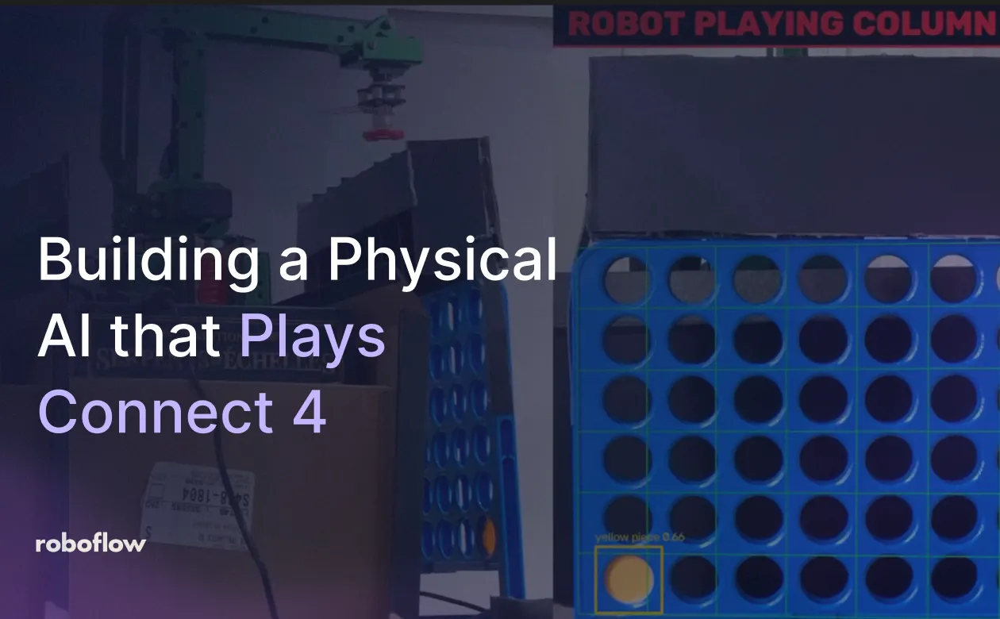
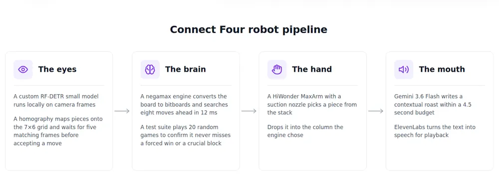
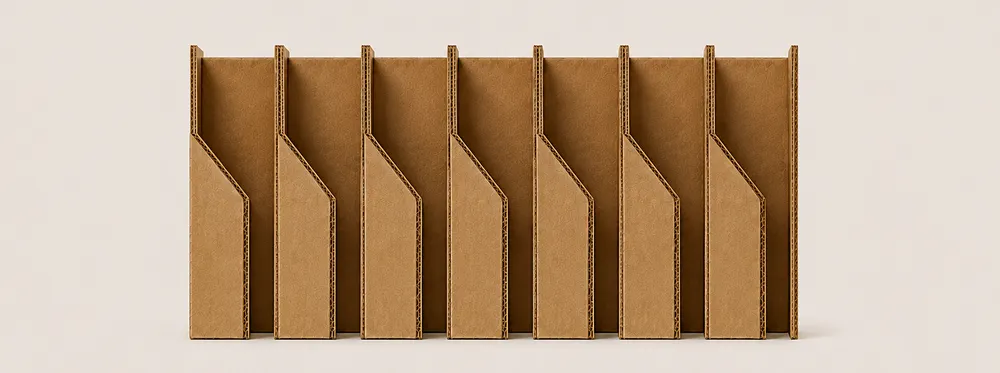

# Connect 4 Robot

A physical Connect 4 opponent that watches the board, chooses a move, drops a
red chip with a robot arm, and talks trash while you play yellow.



Read the [full build writeup on Roboflow](https://roboflow.com/blog/building-a-physical-ai-that-plays-connect-4)
or [watch the demo](https://www.youtube.com/watch?v=1jhJQZQAS4U). The photos and
diagrams below come from the writeup.

## How it works



| Part | What it does |
| --- | --- |
| **Eyes** | A webcam and locally running RF-DETR model detect the board and chips. Camera calibration maps detections to a 7 × 6 game state. |
| **Brain** | The original game uses a depth-8 minimax/negamax search to choose a legal column. |
| **Hand** | A HiWonder MaxArm picks a red chip from a stack with its suction cup and drops it into that column. |
| **Mouth** | Gemini writes board-aware commentary, and ElevenLabs or macOS speech reads it aloud. |

The fullscreen overlay shows the camera feed, detections, the robot's board
state, an advantage bar, and the commentary. **The language model writes the
commentary; it does not choose moves.**

## PyTorch models and demos

The [PyTorch self-play branch](https://github.com/aarnavshah12/connect4-robot/tree/pytorch-self-play)
contains two trained models, their checkpoints, training scripts, and demos:

- **Game player:** A PyTorch policy/value network scores the seven possible
  moves and estimates the position. It first learned from simulated games,
  then trained through self-play reinforcement learning. The demo can use
  neural-guided tree search to look ahead before choosing a move.
- **Board reader:** A PyTorch image classifier reads each of the 42 cells as
  empty, red, yellow, or occluded. It uses calibrated board corners to locate
  the cells in a photo.

You can try both without a camera or robot arm. From a fresh clone:

```bash
git clone https://github.com/aarnavshah12/connect4-robot.git
cd connect4-robot
git switch pytorch-self-play
uv venv .venv --python 3.12
uv pip install --python .venv/bin/python -r requirements-ml.txt

.venv/bin/python play_gui.py      # click a column to play against the bot
.venv/bin/python vision_photo.py  # choose a board photo on macOS
```

In the game window, use **Switch mode** to compare the self-play model with
and without search and with the earlier supervised model. For the photo demo,
click the board's four outer corners in the order shown on screen. It displays
the predicted board and confidence for each cell. On other operating systems,
pass a photo path with `--image /path/to/photo.jpg`.

The [PyTorch learning guide](https://github.com/aarnavshah12/connect4-robot/blob/pytorch-self-play/ml/README.md)
walks through the model and vision training. The [self-play guide](https://github.com/aarnavshah12/connect4-robot/blob/pytorch-self-play/ml/SELF_PLAY.md)
explains the reinforcement learning loop, and the [results](https://github.com/aarnavshah12/connect4-robot/blob/pytorch-self-play/ml/RESULTS.md)
show the measured game and vision evaluations. The original robot workflow is
documented below; the PyTorch code and selected weights live on the linked
branch.

## Physical build

The robot uses a HiWonder MaxArm with an ESP32 running the
`MaxArm_micropython_microUSB` serial firmware, a suction-cup end effector, a
vertical stack of red chips, and a 720p or better webcam aimed at the board.
The human plays yellow; the robot plays red. The factory arm firmware backup is
in `maxarm_factory_backup/`.



The cardboard guide helps each dropped chip land in its intended column. The
[build writeup](https://roboflow.com/blog/building-a-physical-ai-that-plays-connect-4)
shows how the guide and the rest of the rig were built.

### Set up the original robot

```bash
uv venv .venv --python 3.12
uv pip install --python .venv/bin/python -r requirements.txt
cp config.example.yaml config.yaml
```

Edit the gitignored `config.yaml` for your camera, serial port, and API keys.
The RF-DETR model runs locally through Roboflow Inference; its key can also
come from `ROBOFLOW_API_KEY`. Gemini is optional for commentary, and ElevenLabs
is optional for speech: the app has canned lines and a macOS `say` fallback.

### Calibrate and play

1. Run `.venv/bin/python jog.py` or `.venv/bin/python nudge.py` to teach the
   arm its feeder pick point and seven drop positions. These are saved in
   `poses.json`.
2. Run `.venv/bin/python calibrate.py` to mark the four board corners. Press
   `x` if the grid is rotated and `s` to save the calibration.
3. Use `.venv/bin/python debug_vision.py` to inspect detected chips and board
   parsing before a game.
4. Start the game with `.venv/bin/python game.py`. Use
   `.venv/bin/python game.py --no-arm` to place the robot's pieces yourself.

Drop a yellow chip when the overlay says it is your turn. Clearing the board
after a win starts another game. Spoken lines are recorded in `roast_log.jsonl`.

## Code map

| File | Purpose |
| --- | --- |
| `game.py` | Game state machine and turn orchestration |
| `engine.py` | Original negamax search with alpha-beta pruning |
| `vision.py` / `board.py` | Camera inference, calibration, board parsing, and game rules |
| `maxarm.py` | Serial driver for the robot arm |
| `overlay.py` | Fullscreen game display |
| `commentary.py` / `voice.py` | Commentary and speech |
| `jog.py` / `nudge.py` / `calibrate.py` | Arm and camera calibration tools |

The PyTorch training and demo files are listed in the
[branch's learning guide](https://github.com/aarnavshah12/connect4-robot/blob/pytorch-self-play/ml/README.md).

## Tests

Run the hardware-free test suite with:

```bash
.venv/bin/python -m pytest tests/ -q
```

It covers the game engine, board parsing, vision plumbing, arm driver protocol,
overlay, commentary, and turn flow.
